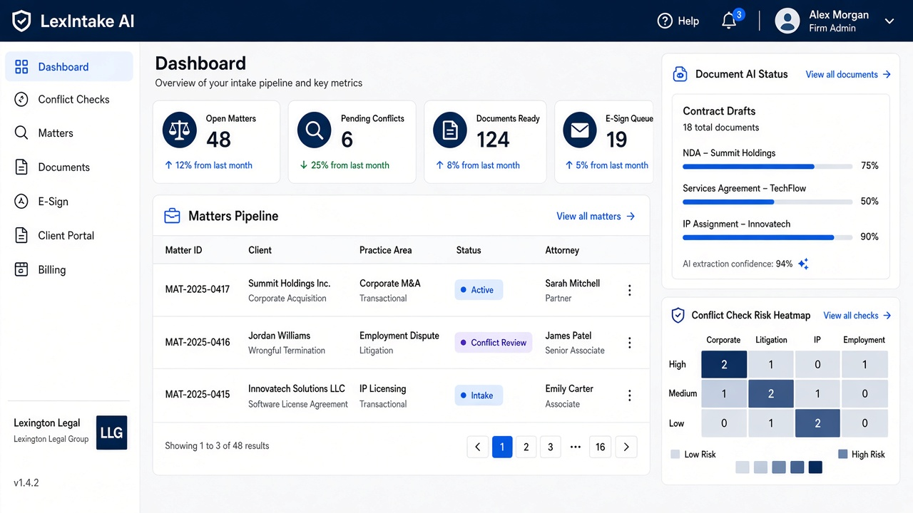

# AI Law Firm Intake & Document Agent



**SEO title:** AI Law Firm Intake & Document Agent | Conflict Checks, Matter Intake, Document AI  
**SEO description:** AI law firm intake and document agent for conflict checks, matter intake, contract drafting assistance, and secure client document workflows.  
**Keywords:** legal intake software, law firm conflict check, matter management, legal document AI, e-sign readiness, client portal for law firms, legal billing notes, Filament Laravel legal tech  
**Author:** Imran Ahmed \<me@imrandev.bd\> · [imrandev.bd](https://imrandev.bd)  
**Accent:** `#1E3A8A` · **Industry:** Legal  
**Repository:** [github.com/imranbru99/ai-law-firm-intake-document-agent](https://github.com/imranbru99/ai-law-firm-intake-document-agent)

---

## Why this product exists

Law firms lose billable hours on the slowest part of the client journey: **intake**. Conflicts are checked in spreadsheets, engagement letters are rewritten from scratch, documents bounce through email, and clients keep asking “what’s the status?” 

**AI Law Firm Intake & Document Agent (LexIntake AI)** is a complete Laravel + Filament business solution that turns intake into a modular operating system: conflict screening, matter creation, document AI assistance, e-sign readiness, client portal messaging, and billing narratives — each module toggleable so boutique firms and large practices can run only what they need.

### Business ROI & time-saver case

| Bottleneck | Without LexIntake | With LexIntake | Typical savings |
|---|---|---|---|
| Conflict check | 30–90 min manual search | Automated party match + risk score | **45–70 min / matter** |
| Engagement draft | 1–3 hours attorney drafting | AI draft + clause risk flags | **1–2 hours / matter** |
| Client status emails | Constant inbox interrupts | Portal + structured messages | **3–5 hrs / week / paralegal** |
| E-sign prep | Ad-hoc PDF chase | Signer packets & readiness states | **20–40 min / packet** |
| Billing narratives | Forgotten late entries | Matter-linked billing notes | Cleaner realization |

For a 10-attorney boutique opening ~20 matters/month, reclaiming even **1.5 hours per matter** at blended rates is a six-figure annual productivity unlock — before considering faster client conversion and fewer conflict surprises.

---

## Product screenshot

The admin dashboard (navy `#1E3A8A` theme) surfaces open matters, pending conflicts, document AI readiness, and e-sign queue widgets designed for legal operations — not generic CRM chrome.

---

## Core modules (all toggleable)

Every module can be enabled/disabled via `.env`, `config/modules.php`, or the **Modules** Filament resource (`module_settings` table). Disabled modules hide from navigation and refuse service-layer execution.

| Module key | Label | What it does |
|---|---|---|
| `conflict_check` | Conflict Check | Adverse party screening, roster/alias matching, risk scoring, review workflow |
| `matter_intake` | Matter Intake | Structured intake → client + matter creation, practice-area routing |
| `document_ai` | Document AI | Contract/engagement drafting assistance, clause suggestions, analysis metadata |
| `esign_readiness` | E-Sign Readiness | Signature packet assembly, signer ordering, ready/sent/complete states |
| `client_portal` | Client Portal | Secure client-facing matter status & messaging |
| `billing_notes` | Billing Notes | Billable time narratives tied to matters |
| `attendance_ops` | Staff Attendance | Optional attendance hub integration (off by default) |

---

## Multi-role users

| Role | Access |
|---|---|
| Super Admin | Full firm control, modules, users |
| Admin | Firm administration & matter ops |
| Manager | Practice oversight, conflict review |
| Staff | Intake, documents, billing notes |
| Client / Customer | Portal-only matter visibility |
| Demo | Seeded showcase user for evaluations |

### Demo credentials (after `db:seed`)

| User | Email | Password |
|---|---|---|
| Demo | `demo@lexintake.test` | `password` |
| Super Admin | `superadmin@lexintake.test` | `password` |
| Admin | `admin@lexintake.test` | `password` |
| Manager | `manager@lexintake.test` | `password` |
| Staff | `staff@lexintake.test` | `password` |
| Client | `client@lexintake.test` | `password` |

---

## Public marketing pages

| Route | Purpose |
|---|---|
| `/` | Hero + live module grid |
| `/features` | Feature deep-dive |
| `/modules` | Toggleable module catalog with ON/OFF status |
| `/pricing` | Solo / Boutique / Enterprise framing |
| `/security` | Role, matter-scope, audit posture |
| `/demo` | Demo credentials CTA |
| `/admin` | Filament admin panel |
| `/portal` | Authenticated client portal |

---

## Technical stack

- **PHP 8.4 / Laravel 13** application core  
- **Filament 5** admin panel (navy primary `#1E3A8A`)  
- **Livewire** interactive admin UI  
- Modular services: `ModuleManager`, `ConflictCheckService`, `MatterIntakeService`, `DocumentAiService`, `EsignReadinessService`, `BillingNoteService`  
- Policies for matters, conflict checks, and legal documents  
- Migrations, models, seeders, feature tests  
- Dockerized (`Dockerfile` + `docker-compose.yml`) with MySQL  

### Packagist packages (`imrandevbd/*`)

| Package | Role in this product |
|---|---|
| `imrandevbd/drutogoti` | Performance / speed helpers |
| `imrandevbd/laravel-admin-panel` | Admin panel extensions |
| `imrandevbd/laravel-ai-catalog` | Online data / catalog assistance patterns |
| `imrandevbd/laravel-ai-hub` | Multi-provider AI drafting & analysis |
| `imrandevbd/laravel-attendance-hub` | Optional staff attendance ops |
| `imrandevbd/laravel-unicode-pdf` | Multilingual PDF generation for legal packs |
| `imrandevbd/laravel-universal-slug` | Unicode-safe slugs for matters & documents |

> **Note:** On Laravel 13, Packagist builds of `drutogoti`, `laravel-admin-panel`, and `laravel-attendance-hub` currently constrain `illuminate/*` to ^11\|^12. This repo declares all seven packages at `dev-main` and ships L13 path compatibility bridges under `packages/` so the application installs cleanly while upstream catches up. `laravel-ai-hub`, `laravel-unicode-pdf`, and `laravel-universal-slug` install from Packagist. `laravel-ai-catalog` uses a local bridge because Packagist `dev-main` requires `laravel-ai-hub:^1.6` which conflicts with root `dev-main`.

---

## Quick start (local)

```bash
composer install
cp .env.example .env
php artisan key:generate
touch database/database.sqlite   # or configure MySQL
php artisan migrate --seed
php artisan serve
```

- Marketing site: [http://127.0.0.1:8000](http://127.0.0.1:8000)  
- Admin: [http://127.0.0.1:8000/admin](http://127.0.0.1:8000/admin)  

### Docker

```bash
docker compose up --build
```

App: [http://localhost:8080](http://localhost:8080) · MySQL published on host `3307`.

---

## Architecture highlights

```
app/
  Enums/UserRole.php
  Filament/Resources/{Clients,Matters,ConflictChecks,LegalDocuments,SignaturePackets,BillingNotes,PortalMessages,ModuleSettings,Users}
  Filament/Widgets/{LegalStatsOverview,RecentMattersWidget}
  Models/{Client,Matter,ConflictCheck,LegalDocument,SignaturePacket,BillingNote,PortalMessage,ModuleSetting}
  Policies/{MatterPolicy,ConflictCheckPolicy,LegalDocumentPolicy}
  Services/{ModuleManager,ConflictCheckService,MatterIntakeService,DocumentAiService,EsignReadinessService,BillingNoteService}
  Http/Controllers/{MarketingController,PortalController}
config/modules.php
config/legal.php
```

---

## Opportunities & roadmap ideas

- Court / jurisdiction packs as downloadable module presets  
- Outside-counsel guidelines checklists per client  
- Privilege-safe AI redaction before portal sharing  
- Trust accounting handoff for retainers  
- Bar-compliant retention policies per practice area  
- Multi-office conflict walls with ethical screen logging  

---

## License & authorship

MIT-licensed portfolio application.  
**Author / committer:** Imran Ahmed \<me@imrandev.bd\> — [https://imrandev.bd](https://imrandev.bd)

---

## 🤝 Let's Connect & Collaborate

I am open to Senior Remote Full-Stack Roles, AI Platform Architecture Contracts, and Enterprise Technical Advisory.

Timezone: UTC+6 (Dhaka / Rangpur, Bangladesh) — Flexible overlap with US, UK, and European business hours.

Delivery Mode: Async-ready, Slack, Discord, Jira, GitHub, and production-first accountability.

| Channel | Address / Handle | Quick Action |
|---|---|---|
| 🌐 Primary Portfolio | [imrandev.bd](https://imrandev.bd) | [Visit Site ↗](https://imrandev.bd) |
| 📦 Packagist Packages | [packagist.org/packages/imrandevbd/](https://packagist.org/packages/imrandevbd/) | [View Packages ↗](https://packagist.org/packages/imrandevbd/) |
| 💼 LinkedIn Profile | [linkedin.com/in/imranbru99](https://linkedin.com/in/imranbru99) | [Connect ↗](https://linkedin.com/in/imranbru99) |
| 🐙 GitHub Profile | [github.com/imranbru99](https://github.com/imranbru99) | [Follow ↗](https://github.com/imranbru99) |
| 💬 WhatsApp Direct | +880 1576-918420 | [Chat Now ↗](https://wa.me/8801576918420) |
| 📧 Direct Email | me@imrandev.bd | [Send Email ↗](mailto:me@imrandev.bd) |
| 🐦 X (Twitter) | [@imrandev_bd](https://x.com/imrandev_bd) | [Follow ↗](https://x.com/imrandev_bd) |
| 📺 YouTube Tech | [@ImranDevBD](https://youtube.com/@ImranDevBD) | [Subscribe ↗](https://youtube.com/@ImranDevBD) |
